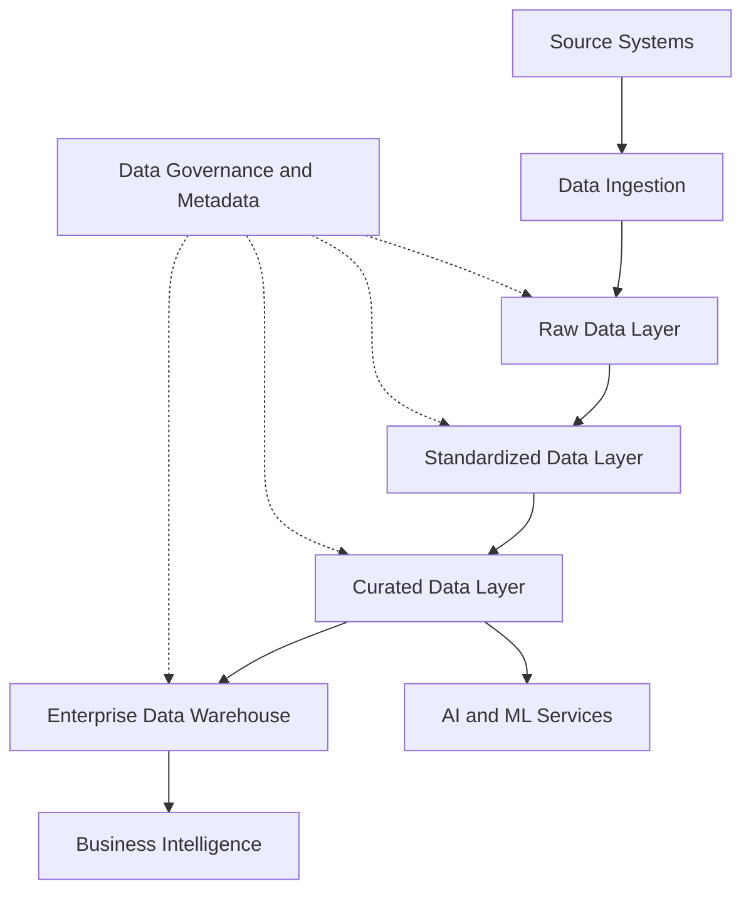

# enterprise-data-architecture
Enterprise data architecture reference implementation showcasing conceptual, logical and physical data modeling, cloud lakehouse architecture, data integration, metadata management, governance and analytics enablement for a retail and e-commerce platform.

# Enterprise Data Architecture – Retail & E-Commerce

## Project Overview

This project demonstrates an end-to-end enterprise data architecture for a modern retail and e-commerce organization.

The architecture supports scalable data integration, enterprise data modeling, cloud modernization, data governance, business intelligence, and AI-ready data capabilities.

## Business Objectives

- Establish a unified enterprise data architecture.
- Enable a Customer 360 view across multiple channels.
- Integrate sales, inventory, product, supplier, and financial data.
- Modernize legacy data platforms using cloud technologies.
- Establish consistent data governance and quality standards.
- Enable advanced analytics and AI/ML capabilities.

## Business Domains

| Domain | Key Data Entities |
|---|---|
| Customer | Customer, Address, Loyalty, Preferences |
| Product | Product, Category, Brand, SKU |
| Sales | Order, Order Item, Payment, Return |
| Inventory | Warehouse, Stock, Inventory Movement |
| Supply Chain | Supplier, Purchase Order, Shipment |
| Finance | Invoice, Transaction, Revenue, Cost |
| Marketing | Campaign, Promotion, Customer Segment |

## Architecture Scope

- Enterprise Conceptual Data Model (CDM)
- Logical Data Model (LDM)
- Physical Data Model (PDM)
- Dimensional Data Modeling
- Enterprise Data Warehouse and Lakehouse
- Source-to-Target Mapping
- ETL/ELT Integration
- Master Data Management
- Metadata Management and Data Lineage
- Data Governance and Data Quality
- Data Security and Privacy
- Architecture Decision Records

## High-Level Architecture

## Technology Stack

| Capability | Reference Technologies |
|---|---|
| Data Ingestion | Azure Data Factory |
| Data Storage | Azure Data Lake Storage Gen2 |
| Data Processing | Azure Databricks, Spark |
| Data Warehouse | Snowflake |
| Data Governance | Microsoft Purview |
| Data Modeling | ER/Studio, Mermaid, SQL |
| Business Intelligence | Power BI |
| Version Control | GitHub |

## Repository Structure

| Directory | Description |
|---|---|
| business-requirements | Business objectives and use cases |
| enterprise-architecture | Architecture diagrams and design |
| conceptual-data-model | Enterprise business entities |
| logical-data-model | Attributes and entity relationships |
| physical-data-model | Database implementation design |
| dimensional-model | Facts and dimensions |
| source-to-target-mapping | Data transformation specifications |
| data-integration | Integration patterns and pipelines |
| data-governance | Governance, metadata and quality |
| cloud-architecture | Cloud platform architecture |
| sql-scripts | Database DDL and SQL examples |
| sample-data | Synthetic datasets |
| architecture-decisions | Architecture decision records |

## Architecture Principles

- Business-driven architecture
- Domain-oriented data design
- Scalability and interoperability
- Security and privacy by design
- Reusable data integration patterns
- Data quality by design
- Cost optimization
- Technology-independent logical modeling

## Project Status

This portfolio project is under active development.

## Disclaimer

This is an independent architecture portfolio project using fictional business scenarios and synthetic data. It does not contain proprietary information from any organization.
